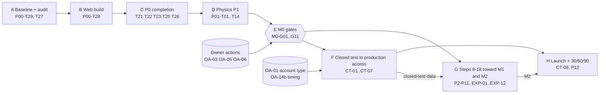

# Master Product Roadmap

> **Status:** plan of record from 2026-10-07 (baseline `master @ d3c6aab`). Revised 2026-10-14 ([A-26](DECISIONS.md)): §8–§16 add the delivery stages, the near-term task inventory, the owner-action register, the experiment backlog, the first-player milestones, the post-test 30/60/90 plan, risks, a change log and research-to-decision traceability. §1–§7 are unchanged apart from a pointer note in §1; the full product vision (mission, players, differentiation, monetization philosophy, open owner questions) is [`../PRODUCT-VISION.md`](../PRODUCT-VISION.md).
>
> **One source of truth per question (never duplicated):**
> - **State** (task status, dashboard, gates, open bugs): [`../STATUS.md`](../STATUS.md) only, including its task board. This roadmap defines tasks and gates; it never records whether they are done (CLAUDE.md rule).
> - Decisions: [`DECISIONS.md`](DECISIONS.md) (its Amendments table overrides entry bodies)
> - Order of work: [`EXECUTION-ORDER.md`](EXECUTION-ORDER.md)
> - Task specs: [`phases/`](phases/). Every task ID in this roadmap is defined there, or in §9 for the stage-level items that have no phase home.
> - Per-task execution plans: `docs/superpowers/plans/` (writing-plans format, written just in time)
> - Session continuity (local, gitignored, not evidence on its own): the SDD ledger `.superpowers/sdd/progress.md` and the per-task briefs in `.superpowers/sdd/p0/`
> - Ranking: [`FEATURE-MATRIX.md`](FEATURE-MATRIX.md) · Metrics: [`SUCCESS-METRICS.md`](SUCCESS-METRICS.md) · Risks: [`RISK-REGISTER.md`](RISK-REGISTER.md)
> - Evidence: [`../research/RESEARCH-SUMMARY.md`](../research/RESEARCH-SUMMARY.md), the market research audit [`../research/2026-10-14-gravity-flow-research-audit.md`](../research/2026-10-14-gravity-flow-research-audit.md) (A-27) and the baseline audit [`../audit/2026-10-07/STATE-AUDIT.md`](../audit/2026-10-07/STATE-AUDIT.md)
>
> The game's working title stays "Gravity Flow" until the naming decision (D-19).

## 1. North star

> Summary only. [`../PRODUCT-VISION.md`](../PRODUCT-VISION.md) elaborates the why and what; where it conflicts with this section or DECISIONS, the plan of record wins until an amendment says otherwise. This roadmap says when and in what order; [`../STATUS.md`](../STATUS.md) says where we are.

We optimise for:
- more players **understanding the game instantly**
- more players **enjoying the core pull**
- more players **returning tomorrow**
- more players **mastering levels**
- more players **sharing**
- more players **choosing** optional ads and purchases

All of it on an architecture that can keep growing for years. We do **not** optimise for feature count or level count.

**The product thesis:** *"You don't move the star — you are gravity."*
- A one-touch, analog, skill-based physics puzzler with a premium cosmic identity.
- Short sessions (3–8 min).
- Fair, honest, cosmetic-only monetization.

**What blocks that today** (from the audit):
1. Trust: purchases, ads, consent, platform behaviour and determinism are broken.
2. Challenge: levels play themselves, wall-hug lanes, par is meaningless, copies.
3. Loop friction: no Retry, auto-advance, cutscenes replay, no relief.
4. Presentation: the render is dim, and so are the store assets.
5. Silence: no return channel and no online anything.

The roadmap fixes them **in that order**, because each depends on the one before:
- Content can't be tuned until physics is deterministic.
- Par can't be set until the loop's clock rules are final.
- Store creative can't be shot until the render is fixed.
- Retention can't be measured until consent-safe telemetry exists.

## 2. Prioritization framework
| Class | Meaning | Rule |
|---|---|---|
| **P0** | Correctness, security, compliance, launch blockers | Done first; nothing ships with an open P0 |
| **P1** | Foundational player value: physics, loop, level quality, render, durability | Done before growth features |
| **P2** | Retention, monetization, growth improvements | Built on P1 foundations; tuned by data |
| **P3** | Experiments and optional future systems | Only when metrics justify them |

**Ranking within a class.** Score = (Player value + Retention + Monetization + Virality, each 1–5) × Confidence (0.5–1.0) ÷ Effort (1–5), with a Risk penalty. The scoring is in [`FEATURE-MATRIX.md`](FEATURE-MATRIX.md).

**Tie-breaker:** the item that unblocks the most downstream items wins. Excitement is never a criterion.

## 3. Milestones
| Milestone | Contents | What it unlocks | Owner gate |
|---|---|---|---|
| **M0 — Truthful Build** | P0 + P1 | Internal-track upload (versionCode ≥ 1000001); owner device validation of purchases (license testers), ads, consent, back/pause, haptics, 30/60/120 Hz parity | Owner: AdMob/RC/Play product setup; device smoke |
| **M1 — Closed Beta** | M0 + P2 (bot v1 gates) + P3 + P4-α (first hour: Worlds 1–3) + P5-A (render/HUD/hint/logo) | Closed test (12 testers × 14 days if the app's dashboard requires it) with real telemetry, under the working title (A-14) | Owner: tester recruitment; name choice + TM knockout can run in parallel |
| **M2 — Launch Candidate** | M1 + P4 (full campaign) + P5 + P6 core (incl. In-App Review) + P7 core + P11 store/brand + **rename applied (D-19/A-14)** | First production release (A-28: full release to the chosen countries; staged rollouts from the first update) | Owner: production access, final name, store assets sign-off |
| **M3 — Live 1.x** | P8, P9, P10, P12 optimisation; iOS track | Growth and live ops by data | Owner: data review cadence |

## 4. Phases

> Phase numbers group the work by domain. **Execution interleaves phases by dependency** (see [`EXECUTION-ORDER.md`](EXECUTION-ORDER.md)).
>
> Changes from the suggested 12-phase list:
> - The **core loop (P3) comes before campaign redesign (P4)**. Par, star rules, the armed-clock semantics (D-02) and fail relief (D-07) define what "difficulty" means. Re-authoring 150 levels before they're fixed would mean tuning twice.
> - **Monetization bugs are in P0.** They are correctness defects; only the monetization *design* lives in P7.
> - **Render correctness (P5-A) is pulled early.** It's cheap, independent of the rest of P5, and required for honest playtests and store assets.

Difficulty scale: L / M / H / XH.

### P0 — Foundation & launch-blocker correctness
- **Objective:** a correct, compliant, honest, maintainable baseline with a single source of truth for state.
- **Player outcome:**
  - Purchases work and restore.
  - Ads never cover live play.
  - Consent is respected, Back and pause behave correctly, and haptics work.
  - Progress survives reinstall or backup, and the game never freezes on an error.
- **Business outcome:**
  - The app can earn and can pass Play/AdMob review.
  - Telemetry is lawful and correct.
  - Docs can be trusted again.
- **Systems affected:** docs/SSOT, repo hygiene, dependencies (Capacitor 8.5.2 security), IAP (`IAP.ts`, `native/revenueCat.ts`), Ads (`Ads.ts`, `native/admob.ts`, `interstitial.ts`), consent (UMP + Firebase consent mode), lifecycle (`main.ts`, `@capacitor/app`, `AudioSynth`), manifest/config, persistence (`*Store.ts` + Preferences mirror), error boundary (`Crash.ts`), analytics hygiene, store copy honesty, versioning.
- **Dependencies:** none (first phase).
- **Difficulty:** engineering M · design L · QA **H** (device-only behaviours).
- **Risk:** medium. Native behaviour can only be fully proven on a device; mitigated by unit-testing pure logic and a device checklist.
- **Expected upside:** turns a non-shippable RC into a shippable, monetizable build.
- **Success metrics:**
  - 0 open P0s
  - `npm audit --omit=dev` shows 0 critical
  - every purchase/restore/pending/refund row of the license-tester matrix passes (device)
  - no interstitial ever shown with `simMs` running
  - crash-free sessions ≥ 99.5% on internal
- **Must NOT be done yet:** gameplay/content changes, visual redesign, economy redesign, new features, renaming.
- **Plan:** [`phases/P00-foundation.md`](phases/P00-foundation.md)

### P1 — Core physics determinism
- **Objective:** identical gameplay at 30/60/90/120/144 Hz, plus deterministic restarts and replays (D-01–D-03).
- **Player outcome:** the pull feels the same on every phone; timers are fair; pausing, backgrounding or watching an ad never costs a star or a life.
- **Business outcome:** difficulty tuning, par, leaderboards and the QA bot become meaningful.
- **Systems affected:**
  - New `src/sim/` (forces, step hooks, sim clock, kinematics); new `src/sim/frameHarness` test.
  - `GameScene`/`EndlessScene` update loops; `Hazard`/`MovingPlatform`/`Goal` motion.
  - Timers (countdown, par chip, best time); ghost recorder.
- **Dependencies:** P0 lifecycle pause hooks.
- **Difficulty:** engineering **H** · design L · QA M (automated harness).
- **Risk:** medium-high. It touches every level's feel; mitigated by the multi-rate harness, before/after trajectory snapshots, and keeping constants unchanged.
- **Expected upside:** removes the largest hidden correctness bug; unblocks P2–P4 and P8 fairness.
- **Success metrics:**
  - Trajectory divergence across 30–144 Hz ≤ 1 px at t = 2 s for the fixed scenarios.
  - Replay determinism 100% (same input log → same outcome).
  - All timers on sim time; zero wall-clock reads in gameplay code (lint rule).
- **Must NOT be done yet:** par re-tuning, level edits, zone retune (D-04 waits for P2's fight test).
- **Plan:** [`phases/P01-physics.md`](phases/P01-physics.md)

### P2 — Level engine & level QA system
- **Objective:** a scalable content system: level data model v2 (D-05), strong static validators, a headless bot (D-06), and a machine-readable quality report, with CI gates.
- **Player outcome:** indirect but decisive. Every shipped level has to prove it is solvable, not self-solving, not bypassable, fair and distinct.
- **Business outcome:** content can scale to hundreds of levels without quality collapse; human playtest time goes only to flagged levels.
- **Systems affected:**
  - `src/types` (LevelConfig v2) and `src/config/levels/*` (ids, metadata).
  - `worlds.ts` (explicit level lists), with ProgressStore/GhostStore migration to ids.
  - New `scripts/levelsim/`, `src/sim/validate/` and CI.
- **Dependencies:** P1 (`src/sim/` + deterministic stepping).
- **Difficulty:** engineering **H** · design M · QA M.
- **Risk:** medium. Bot cost and false positives; mitigated by tiered agents, a "designer quick-check" (< 30 s) and human triage.
- **Expected upside:** **highest long-term leverage in the plan**; it's the quality engine for P4, P6 (dailies) and P8 (chunks).
- **Success metrics:**
  - 100% of levels have id/idea/role.
  - The report covers 150/150 levels.
  - Agents A0–A3 run in CI under 3 minutes.
  - Nightly A4–A6 + ablation complete.
  - Known audit defects reproduced by the bot: L11/L12 self-solve, L40 wall-hug, L60 decoy chain, L74 exit-in-hazard.
- **Must NOT be done yet:** mass level rewrites (that's P4); new mechanics.
- **Plans:** [`phases/P02-level-engine-qa.md`](phases/P02-level-engine-qa.md), [`../architecture/LEVEL-ENGINE.md`](../architecture/LEVEL-ENGINE.md), [`../architecture/LEVEL-QA-SIMULATION.md`](../architecture/LEVEL-QA-SIMULATION.md)

### P3 — Core "one more try" loop
- **Objective:** maximise clarity, agency, mastery, failure readability, reward and retry speed (D-02, D-07, D-08).
- **Player outcome:**
  - NEXT/RETRY with no auto-advance.
  - Instant, cause-stamped retries with no repeated cutscenes.
  - The clock starts on first touch.
  - Hints that teach without spoiling, and a relief ladder that keeps them moving.
  - Missed-star feedback that invites mastery.
- **Business outcome:** higher attempts per session, completion and D1. Interstitials move to a policy-safe placement (after NEXT).
- **Systems affected:**
  - `GameScene` (result/death/title-card flows): split into `ResultPanel`, `DeathStamp`, `HintSystem`, `ReliefLadder` modules.
  - `ProgressStore` (attempt counts, assisted flag, open frontier); `scoring.ts` (assisted ⇒ no par star).
  - `onboarding.ts`; hint data (question-style rewrite).
- **Dependencies:** P1 (armed sim clock), P2 (bot route for "Show me" ghosts).
- **Difficulty:** engineering M · design **H** · QA M.
- **Risk:** medium. The relief ladder could hollow out challenge; it's opt-in and par-star-excluded.
- **Expected upside:** high. This is the core loop the existing mastery systems were waiting for.
- **Success metrics:**
  - Death → control ≤ 600 ms.
  - Retry from result ≤ 1 tap.
  - Title cards on retry = 0.
  - FASR (first-attempt success rate) and APS (attempts per success) per level measurable.
  - Relief usage < 15% of attempts in W1–4 (telemetry, M1+).
- **Must NOT be done yet:** campaign-wide retuning (P4); economy changes (P7).
- **Plan:** [`phases/P03-core-loop.md`](phases/P03-core-loop.md)

### P4 — Campaign redesign & content quality
- **Objective:** a campaign that teaches → experiments → develops → twists → combines → masters, with a distinct identity for every world and a back half that feels different from the front.
- **Player outcome:** a real difficulty curve (sawtooth), no self-solving or bypassed levels, meaningful par and gems, bosses that are climaxes, and a finale that pays off "bring the star home".
- **Business outcome:** reviews, D7/D30, word of mouth; "plays itself" stops being the first impression.
- **Systems affected:** all level data; `worlds.ts`/`worldThemes.ts`; zone strength constant (D-04); 2–4 cheap mechanic variants (moving wells, polarity flip, anti-gravity field, limited presses); the `Obstacle` angle render fix; boss phase support.
- **Dependencies:** P2 (bot gates and metrics), P3 (par/relief semantics).
- **Difficulty:** engineering M · design **XH** · QA **H** (bot + human).
- **Risk:** high. It's the largest content effort. Mitigated by doing **P4-α (Worlds 1–3)** first for M1, then data-informed waves.
- **Expected upside:** very high. The campaign is the product.
- **Success metrics:**
  - 0 levels fail CI bot gates.
  - Duplicate score < 0.85 for every level pair (excluding labelled remixes).
  - Bot-derived par puts the 3★ rate at 25–40% (refit with human data).
  - Boss ≥ the world's hardest non-boss level.
  - FASR targets per world slot met in closed test.
- **Must NOT be done yet:** increasing the level count; new worlds; Expert packs.
- **Plans:** [`phases/P04-campaign.md`](phases/P04-campaign.md), [`../design/GAMEPLAY-DESIGN.md`](../design/GAMEPLAY-DESIGN.md)

### P5 — UX/UI, visual & motion system
- **Objective:**
  - A reusable design language (tokens v2, component kit, motion vocabulary).
  - A bright, readable render that works on low-end Android.
  - Accessibility options.
- **Player outcome:** looks premium in motion; clear hierarchy; consistent buttons and overlays; smooth scrolling; a satisfying shop; a finale ceremony; options for motion, text size and toggle-hold.
- **Business outcome:** store conversion, session length, shop conversion.
- **Systems affected:**
  - Rendering: `theme.config.ts` (tokens v2), new `utils/quality.ts`, a parallel `HudScene` (D-13; a second camera is only the fallback), `utils/motion.ts`, `utils/shake.ts`.
  - UI kit: `ui/*` (Button variants, Modal, ResultPanel, Toast, ScrollView, LevelNode, Shop components); Settings v2.
  - Screens and assets: splash fast path, EndScene finale, logo/icon assets.
- **Dependencies:** none for **P5-A** (render/HUD/hint/logo, scheduled early); the rest after P3 (ResultPanel) and alongside P4.
- **Difficulty:** engineering M · design **H** · QA M (device perf).
- **Risk:** medium. GPU cost on low-end devices; mitigated by quality tiers and a persisted watchdog.
- **Expected upside:** high for conversion and perceived quality.
- **Success metrics:**
  - Gameplay peak luminance ≥ 230 in captures.
  - HUD text contrast ≥ 4.5:1 as rendered.
  - 0 text under 12 px.
  - 0 touch targets under 48 px.
  - p95 frame time ≤ 20 ms on the Mid tier reference device.
  - Reduced-motion audit passes.
- **Must NOT be done yet:** illustrated art pipeline, 3D, Phaser 4.
- **Plans:** [`phases/P05-ux-visual.md`](phases/P05-ux-visual.md), [`../design/UX-UI-MOTION.md`](../design/UX-UI-MOTION.md)

### P6 — Retention & meta progression
- **Objective:** one coherent return loop (daily habit, weekly goal, mastery collection) without notification spam or dark patterns.
- **Player outcome:**
  - A Daily worth sharing.
  - Visible streaks and calendar.
  - Missions that send players across modes.
  - World and boss mastery rewards.
  - Post-campaign content (Remix, Boss Rush, Time Attack).
  - Gentle, opt-in reminders.
- **Business outcome:** D1/D7/D30, sessions/DAU, ad inventory; measurable through analytics v2.
- **Systems affected:**
  - Daily (pipeline, dated schedule, share card): `daily.ts`/`DailyStore`.
  - Login calendar (pause, not reset); missions (new); achievements v2 (+PGS mapping later).
  - Collections; post-game modes; local notifications; Remote Config; analytics taxonomy v2.
- **Dependencies:** P0 (consent), P2 (daily pipeline), P3/P4 (stable campaign), P5 components.
- **Difficulty:** engineering M · design H · QA M.
- **Risk:** medium. Regulation (EU DFA) and spam perception; mitigated by D-15/D-18.
- **Expected upside:** high for D7/D30.
- **Success metrics:**
  - D1 ≥ 30%, D7 ≥ 8%, D30 ≥ 3% (re-baselined to published bands, A-18; stretch targets in [`SUCCESS-METRICS.md`](SUCCESS-METRICS.md)).
  - Daily participation ≥ 25% of DAU.
  - Notification opt-in ≥ 35% of prompted players; notification disable rate < 3%/week.
- **Must NOT be done yet:** battle pass, event currency, server-run events.
- **Plans:** [`phases/P06-retention.md`](phases/P06-retention.md), [`../design/RETENTION.md`](../design/RETENTION.md), [`../analytics/ANALYTICS-PLAN.md`](../analytics/ANALYTICS-PLAN.md)

### P7 — Monetization design
- **Objective:** an intentional, ethical economy and offer architecture on top of the P0-correct plumbing.
- **Player outcome:** meaningful things to earn and spend; fair, clearly labelled optional ads; purchases that feel like support, not pressure.
- **Business outcome:** ARPDAU and payer conversion without hurting retention; a whale outlet that isn't predatory.
- **Systems affected:**
  - Currency merge (D-23) with migration; shop (Spotlight rotation, try-on previews).
  - Offers (Starter after the W1 boss, No-Ads+, Supporter, seasonal packs).
  - Ad caps via Remote Config; rewarded "Show me" token integration.
  - RevenueCat Offerings experiments.
- **Dependencies:** P0, P5 (shop components), P6 (Remote Config, telemetry).
- **Difficulty:** engineering M · design H · QA M (license testers).
- **Risk:** medium. Brand trust; mitigated by never selling currency, hints or progress.
- **Expected upside:** medium-high relative to today's $0.
- **Success metrics:**
  - Rewarded opt-in ≥ 20% of offers.
  - Interstitial impressions ≤ 1.5 per DAU.
  - Payer conversion ≥ 1.5%.
  - Retention delta between ad-cap cohorts within ±1 pp.
- **Must NOT be done yet:** subscriptions, gacha, energy, paid currency.
- **Plans:** [`phases/P07-monetization.md`](phases/P07-monetization.md), [`../design/MONETIZATION.md`](../design/MONETIZATION.md)

### P8 — Gravity Run 2.0 & competitive systems
- **Objective:** an endless/weekly mode players return to repeatedly (D-22, D-17).
- **Player outcome:** fresh-feeling runs; escalation after the speed cap; pause; PB ghost; a weekly board that's real.
- **Business outcome:** session frequency, ad inventory (revive), a social hook.
- **Systems affected:**
  - Endless content: chunk pipeline (authoring + validator + bot pair-check); `utils/endless.ts` (biomes, mirroring, jitter).
  - `EndlessScene` (pause, telemetry, missing mechanics).
  - Competition: local PGS plugin (Java, A-13); `Leaderboard.ts` swap. The `weekKey` alignment itself lands earlier, in P6.
- **Dependencies:** P1, P2 (bot), P0 lifecycle.
- **Difficulty:** engineering **H** · design H · QA M.
- **Risk:** medium (native plugin, anti-cheat).
- **Expected upside:** medium-high.
- **Success metrics:**
  - Runs/DAU ≥ 1.5 among Run adopters.
  - Weekly participation ≥ 15% of WAU.
  - Median run 60–180 s.
  - Leaderboard submit success ≥ 99%.
- **Must NOT be done yet:** Firestore boards, friend ghosts, tournaments.
- **Plans:** [`phases/P08-gravity-run.md`](phases/P08-gravity-run.md), [`../design/GRAVITY-RUN.md`](../design/GRAVITY-RUN.md)

### P9 — Social & viral
- **Objective:** turn satisfying moments into installs, with genuine fit only (D-16).
- **Player outcome:** share a Daily result card or a run; challenge a friend to a weekly seed.
- **Business outcome:** organic installs (K-factor), store rating volume.
- **Systems affected:**
  - Sharing: `@capacitor/share` + Filesystem, share-card renderer (`utils/Share.ts`).
  - Links: App Links + `assetlinks.json` on the user site/custom domain, web landing route, Install Referrer.
  - (In-App Review and the Daily share card moved to P6/M2, A-12.)
- **Dependencies:** P6 (daily), P8 (weekly seeds), P11 (domain/website).
- **Difficulty:** engineering M · design M · QA M.
- **Risk:** low-medium (link verification).
- **Expected upside:** medium, high variance.
- **Success metrics:** shares/DAU ≥ 3%; share→install attribution measured; rating ≥ 4.5 with volume.
- **Must NOT be done yet:** referral rewards, UGC browsing.
- **Plans:** [`phases/P09-social.md`](phases/P09-social.md), [`../design/SOCIAL-VIRAL.md`](../design/SOCIAL-VIRAL.md)

### P10 — Live ops seams
- **Objective:** extension points for seasons, events, modifiers and themed weeks, as **data, not a platform** (D-14, D-30).
- **Player outcome:** weekly modifier twists, seasonal palettes, earned limited cosmetics that return in a vault.
- **Business outcome:** reactivation; cosmetic event revenue at low operating cost.
- **Systems affected:** `event_calendar` Remote Config schema + client resolver; Weekly modifier rotation; seasonal palettes via `worldThemes`; earned cosmetic drops; event card in RunSelect/MainMenu.
- **Dependencies:** P6 (Remote Config), P7 (cosmetic pipeline), P8 (weekly).
- **Difficulty:** engineering M · design M · QA L.
- **Risk:** content-treadmill fatigue (solo dev).
- **Expected upside:** medium.
- **Success metrics:** event participation ≥ 20% of WAU; D7 of participants vs non-participants; zero crashes on unknown event kinds.
- **Must NOT be done yet:** battle pass, event currency, server events.
- **Plans:** [`phases/P10-live-ops.md`](phases/P10-live-ops.md), [`../design/LIVE-OPS.md`](../design/LIVE-OPS.md)

### P11 — Brand, ASO & store conversion
- **Objective:** a defensible name, honest and high-converting store presence, a website (also needed for app-ads.txt and assetlinks).
- **Player outcome:** understands the game from the first two screenshots; the name is memorable.
- **Business outcome:** store conversion, organic search, AdMob verification.
- **Systems affected:**
  - Brand: `BRAND` config, logo/icon/feature assets.
  - Store listing: copy, 9:16 screenshot set with captions, promo video, localization (top 9 languages), custom store listings, experiments.
  - Infrastructure: website + `app-ads.txt` + `assetlinks.json`.
- **Dependencies:** D-19 owner choice; P5-A render fix (before any capture); P4-α (content on screen).
- **Difficulty:** engineering L · design H · QA L.
- **Risk:** trademark (D-19).
- **Expected upside:** high (installs are the binding constraint).
- **Success metrics:** store listing conversion ≥ 30% (visitors → installers, organic); first-two-screenshots experiment winner; app-ads.txt verified.
- **Must NOT be done yet:** paid UA at scale.
- **Plans:** [`phases/P11-brand-aso.md`](phases/P11-brand-aso.md), [`../launch/STORE-LAUNCH-PLAN.md`](../launch/STORE-LAUNCH-PLAN.md), [`../launch/NAMING-STUDY.md`](../launch/NAMING-STUDY.md)

### P12 — Launch & post-launch optimisation
- **Objective:** ship safely, then improve by data. Includes the iOS port track (D-29).
- **Player outcome:** a stable launch; regular improvements.
- **Business outcome:** production access, a first release to the chosen countries and staged rollouts for updates (A-28), vitals health, an analytics review cadence, iOS revenue later.
- **Systems affected:** release engineering (versionCode, CI Android build, tags/Releases), Play Console forms, vitals monitoring, A/B programme, iOS platform.
- **Dependencies:** M2.
- **Difficulty:** engineering M · design L · QA H.
- **Risk:** review rejection; vitals breach.
- **Expected upside:** realises all prior value.
- **Success metrics:**
  - Crash rate < 1.09%, ANR < 0.47%.
  - Staged rollouts 20→50→100% without regressions, from the first update on (A-28).
  - Weekly metrics review held.
- **Must NOT be done yet:** iOS before the Android launch is stable.
- **Plans:** [`phases/P12-launch.md`](phases/P12-launch.md), [`../launch/STORE-LAUNCH-PLAN.md`](../launch/STORE-LAUNCH-PLAN.md)

## 5. Cross-cutting tracks
| Track | Where | Notes |
|---|---|---|
| Documentation & SSOT | P0 task 1, then every phase end | `docs/STATUS.md` (generated facts) + this roadmap + decisions |
| Analytics | P0 (hygiene/consent) → P6 (taxonomy v2) → continuous | Every event must answer a product question |
| Accessibility | P5 (system) + every UI task | Reduced motion, contrast, 48 px targets, toggle-hold |
| Performance | P1 (sim), P5 (render), every phase gate | Quality tiers; <20 bodies; particle budgets |
| Naming / brand | USER-GATED (D-19) → P11 | No repo renames until the owner decides |

## 6. Quality gates (every phase)
Each gate result is reported as **VERIFIED** (command output), **INFERRED**, or **REQUIRES HUMAN DEVICE TEST**.

1. `npx tsc --noEmit`
2. `npx vitest run`
3. `npm run build`
4. `./gradlew assembleDebug`, with the JDK passed via command line or env, never a committed path
5. The level validators + bot fast agents (from P2 on)
6. Headless boot smoke (all scenes, zero console errors)
7. The multi-rate physics harness (from P1 on)
8. `npm audit --omit=dev`
9. A code-review pass (`superpowers:requesting-code-review`)

## 7. Guardrails
- No feature for its own sake, and no level-count growth before quality.
- Don't rebuild working systems; reuse first.
- Never sacrifice low-end performance for visuals.
- No pay-to-win. Never sell currency, hints or progress.
- No ad spam; no unnecessary data collection.
- Bots are not human playtests.
- Never trust stale docs.
- Research before major architecture.
- Prefer data-driven systems, and keep the codebase simple.

## 8. Delivery stages (added 2026-10-14, A-26)

The phases in §4 group work by domain. The stages below group it by **delivery outcome**, so it is clear what has to be true before the next stage starts. A stage is not a new phase: each one maps onto existing phases, milestones and task IDs, and [`EXECUTION-ORDER.md`](EXECUTION-ORDER.md) stays the order of work. Where a stage letter and a phase number could be confused, the phase number (P0–P12) is the canonical ID.

| Stage | Outcome | Maps to | Entry condition | Exit condition (acceptance) |
|---|---|---|---|---|
| **A. Baseline, audit integrity, planning** | The recorded state matches the repo; the research evidence is tracked, corrected and traceable | P0 Step 5: P00-T29, P00-T27 | Recovery report of 2026-10-14 | Planning docs agree with each other and with the repo; the STATUS task board exists; the research audit and notes are tracked, with corrections in a separate, logged revision; the preliminary report is archived as superseded; CI green |
| **B. Web build reliability** | The public web build deploys again | P00-T28 | Stage A committed (separate commit, no shared files) | The Vercel Preview for the fix commit is READY, with a build log showing `tsc` and `vite build` passing; the Preview serves the game; the Production deployment created by the normal `master` fast-forward is READY (gate G-WEB, §9.2); STATUS B-14 closed with this evidence |
| **C. P0 completion** | No permanent freeze, no data loss, lawful and measurable telemetry, honest listing; P0 closed | P00-T21, T22, T23, T25, T26 | Stage B exit | Each task's definition of done (§9.2); P0 final review done; 0 open P0 bugs other than the owner-blocked B-01 and B-05, and B-03, which Stage D fixes; device rows scheduled for the M0 session |
| **D. Physics determinism** | The pull feels identical at 30–144 Hz; replays are deterministic | P1: P01-T01–T14 (Steps 6–7) | Stage C exit. Step 6 technically needs only Step 2; it is sequenced after C to keep one change in flight on one branch | P1 success metrics (§4); multi-rate harness green in CI; replay fixtures match in Node and the browser; `compare-p1.md` reviewed; A/B builds ready for the owner |
| **E. M0 release readiness** | A truthful build on the Play internal track | M0 gates M0-G01–G11 (§9.4) | Stage D exit; OA-03, OA-05, OA-06 done | Every M0 gate verified and labelled with its verification type from §9.4 (automated, local build, real device, owner sign-off); tag `v1.0.0-rc.2` |
| **F. Closed test to production access** | Real people understand "hold to pull"; Play grants production access | CT-01–CT-07 (§9.5), P12-T09 | M0, and OA-12 (Data safety is required for any closed track). The closed test starts at M0 if OA-01 shows the 12-tester rule applies and OA-14b is approved; otherwise at M1 (EXECUTION-ORDER) | "First 20" gate passed (§12) and production access granted (CT-06). If M1 comes first, "First 100" is evaluated too (CT-07) |
| **G. Product improvement toward the launch candidate** | Investment follows evidence, not feature envy | P2–P11 (EXECUTION-ORDER Steps 8–18), experiments EXP-01–EXP-12 (§11) | M0. It runs **alongside** Stage F: Steps 8–13 lead to M1; Steps 15–18 use the closed-test data | M2 Launch Candidate (EXECUTION-ORDER); each phase's own success metrics (§4) |
| **H. Launch and post-launch 30/60/90** | A stable first public release, then improvement by data | CT-08, P12 (Step 19 on, A-28), §13 | M2 and production access (Stages F and G both done) | The "First 1,000" and "First 10,000" gates (§12) and the continue / pivot / stop criteria in §13 |

## 9. Task inventory

### 9.1 How to read it
- **Current status lives in [`../STATUS.md`](../STATUS.md) → "Task board"**, keyed by the IDs below. That table is the current-state dashboard. Nothing in this file says whether a task is done.
- **Priority** uses §2 (P0 correctness/launch blocker · P1 foundational player value · P2 growth by data · P3 experiments).
- **Effort** is XS / S / M / L. No hour or day estimates are given where they cannot be estimated reliably.
- **Workflow for every substantial task** (EXECUTION-ORDER "Per-step working agreement"):
  1. Read the brief and the ledger.
  2. Fold in prior review findings.
  3. Write or refresh the plan.
  4. Implement, with TDD where the logic is pure.
  5. Verify.
  6. Get a review (`superpowers:requesting-code-review`).
  7. Fix, and re-review until Approved.
  8. Update STATUS, CHANGELOG and the phase doc.
  9. Commit only reviewed files.
  10. Confirm CI.
- **Evidence words** follow §6: VERIFIED (command output), INFERRED, REQUIRES HUMAN DEVICE TEST.

### 9.2 Stages A–C: executable specs

**P00-T29 — Roadmap and planning-system sync** · Priority P0 (every later session resumes from these docs) · Effort M
- **Problem.** The 2026-10-14 recovery found several planning gaps:
  - No task board, and no stage, owner-action, first-player or 30/60/90 plan.
  - Fold-ins from earlier reviews existed only in the local, gitignored SDD ledger.
  - Stale references: `TECHNICAL-ARCHITECTURE.md` still called the `.ai/*` links tracked, and `docs/superpowers/plans/` was missing.
  - A broken Vercel deployment was not recorded anywhere.
- **Depends on:** the recovery report. **Blocks:** nothing technically; it sets the IDs and order for everything else.
- **Scope:**
  - This roadmap §8–§15.
  - DECISIONS A-26 and A-27.
  - EXECUTION-ORDER: the Step 5 order, how to resume, and the working agreement.
  - The P00 phase doc: T27–T29 specs, fold-ins for T21–T26, and the status line.
  - STATUS: task board, OA IDs on the gates, open bug B-14, next actions and decisions log.
  - RISK-REGISTER R-48 to R-51; the `TECHNICAL-ARCHITECTURE.md` `.ai` line; the roadmap index; CHANGELOG.
- **Non-goals:** code changes; changing the P0 → P1 → M0 order; adopting research proposals that need the owner (OA-14).
- **Definition of done:**
  - The documents above agree with each other.
  - `npm run facts:check`, `npx tsc --noEmit` and `npm test` pass.
  - One docs commit; CI green.
- **Evidence to close:** the commit hash and the CI run id. **Rollback:** revert the commit (docs only).

**P00-T27 — Research audit integrity** · Priority P0 (A-27: the audit is now an evidence input for T23, T25, T26 and P1, so its citations must hold) · Effort S
- **Problem.** The audit `docs/research/2026-10-14-gravity-flow-research-audit.md`, its 6 research notes and the preliminary `deep-research-report.md` were untracked.
- **Citation spot-check of 2026-10-14.** 16 external citations were checked. 12 fully support their claims, and 4 overstate them:
  - The GameAnalytics sample size and quartiles are cited to the wrong mirror, and "≈80th/85th percentile" is an interpolation.
  - The short-description rules come from Play's store-listing guidance (`answer/9866151`), not the metadata policy.
  - Candy Crush "$1.01B" is not in the cited text.
  - "of DAU" is not in the Unity rewarded-ad source.
- **The source video** (`ScreenRecording_10-14-2026 05-43-17_1.mp4`, uploaded to a ChatGPT session) was never accessible to any research agent.
- **Depends on:** P00-T29. **Blocks:** T25 (copy rules), T26 (ad checks) and OA-14 (A-18 relabel evidence).
- **Scope, in two commits:**
  1. Track the originals verbatim: the audit, the notes, and the preliminary report moved to `docs/archive/2026-10-14/` with a README marking it superseded.
  2. Corrections to the audit only. Fix the four overstated citations and the percentile wording, record the video limitation, and update the path of the audited report. Add a revision log. The notes stay verbatim as captured evidence, and their known errors are listed in the revision log.
- **Non-goals:** new research; re-running the review pulls; video analysis (OA-15).
- **Definition of done:**
  - `git log` shows the verbatim snapshot and the correction commit separately.
  - Every correction cites a source that was read on 2026-10-14.
  - No other files are in either commit.
- **Evidence to close:** both commit hashes; `git show --stat` for each.

**P00-T28 — Vercel web build repair (B-14)** · Priority P0 (found 2026-10-14: the public web build had been stuck on the 2026-10-08 code `7d39c12` since P00-T20, and every push created a failed deployment) · Effort XS
- **Root cause (VERIFIED, Vercel build log, deployment `dpl_Bbptbe6pKGSa7dTHfDdNvB2x1vEV`):**
  - The deploy fails with `TS2307: Cannot find module '../../scripts/lib/releaseCheck.mjs'` in `src/config/releaseConfig.test.ts` and `releaseBuild.test.ts`.
  - `.vercelignore` excludes `scripts/`, while `npm run build` runs `tsc` over all of `src/`, tests included.
  - GitHub CI is unaffected because it has the full checkout.
- **Depends on:** P00-T27 committed (separate commit; no shared files). **Blocks:** Stage C on the same branch (one change in flight).
- **Scope:** remove `scripts` from `.vercelignore`. This is the smallest robust change: tracked `scripts/` is about 0.34 MB, and future `src` tests may import other tooling modules. The regression guard `src/config/deployIgnore.test.ts` fails if any file `tsc` reads sits under a path the upload excludes.
- **Non-goals:**
  - Changing `tsconfig` or `npm run build` (local and CI behaviour must stay identical).
  - Changing any Vercel project setting.
  - Manually promoting a deployment.
- **Definition of done (gate G-WEB):**
  1. Local `npx tsc --noEmit`, `npm test` and `npm run build` pass.
  2. After the push, the Vercel Preview for this exact commit is READY, and its build log shows `tsc` and `vite build` finishing.
  3. The Preview URL serves `index.html` and the hashed JS bundle (read through the Vercel tools, since Previews are protected).
  4. After the normal fast-forward of `master`, the Production deployment for the same commit is READY, and the production alias serves the new build.
  5. STATUS B-14 is closed with the deployment IDs.
- **Rollback:** Vercel instant rollback to `7d39c12` stays available, and `git revert` of the fix commit restores the old upload. The guard test would then fail, as intended.

**P00-T21 — Frame guard + error overlay + Crashlytics** · Priority P0 (B-10: an uncaught frame error freezes the game permanently) · Effort M
- **Spec:** [`phases/P00-foundation.md`](phases/P00-foundation.md) Step 5, plus these fold-ins:
  - `ctx.expectSignal(matcher)` seam in the harness (TODO `scripts/harness/lib/signals.mjs:7`).
  - `lifecycle.ts` must report the activity state even when `runLifecycle` throws: use `try/finally`, or report first.
  - Enforce `CRASH_MAX_PER_SESSION`.
- **Depends on:** T24, T28.
- **Acceptance:**
  - DEV `window.__crashTest()` makes three throws inside `update`; the overlay appears and the smoke run asserts it.
  - Unit tests for `frameGuard` and `stackParse`.
  - **Owner:** a stack-traced test non-fatal is visible in Crashlytics from an internal build (M0-G09).
- **Non-goals:** new analytics events (T23).

**P00-T22 — Store validation + backups + migration 3** · Priority P0 (R-19: data loss is unrecoverable trust damage) · Effort M
- **Spec:** the P00 phase doc, plus fold-ins:
  - Migration steps must be re-runnable and must re-check before deleting (a kill after migration must not resurrect a key).
  - Delete with `ctx.remove` only, never `Saves.remove`.
  - Every new persisted key goes through `Saves.write`.
- **Depends on:** T21 (shares `main.ts` and the harness signal seam).
- **Acceptance:** writing `"null"` into `gravity-flow:progress:v9` and reloading restores from `:bak`, driven by a DEV hook in the boot-smoke `--mode=dev` leg. Codec, schema and migration unit tests.

**P00-T23 — Analytics hygiene (A-10)** · Priority P0 (B-06 remainder: lawful, valid, measurable events) · Effort M
- **Spec:** the P00 phase doc, plus fold-ins:
  - The pre-consent queue flushes inside `Analytics.applyConsent`, and nothing is sent before consent.
  - Remove the reserved `session_start` (still at `src/services/analyticsEvents.ts:39`).
  - A manual `screen_view`.
  - `level_start` / `level_end{success, cause, attempt, duration_ms}` with `level_id` and `level`.
  - Research input (audit §8, recommendation 3): `level_end` must answer time-to-first-win and the World 1 funnel without new event families.
- **Depends on:** T22.
- **Acceptance:**
  - `git grep -n "session_start" src` matches only the reserved-name list in the test.
  - Queue and lint tests pass.
  - **Owner:** DebugView shows one `screen_view` per scene and zero `firebase_error`.

**P00-T25 — Honest store copy + Data Safety + privacy drafts** · Priority P0 (B-07: metadata policy) · Effort M
- **Spec:** the P00 phase doc, plus the corrected audit as the copy checklist (audit §8 recommendation 4). The checklist:
  - Keep "Hold to pull a lost star home".
  - Remove the "leaderboard" claims (the boards are local only).
  - No listing art with child appeal (youthful animation, young characters): for a 13+ app it can trigger rejection, and Play may treat 13–15 as children in some locales (audit r4). This also applies to the Step 14 creative.
  - Remove "Same run for everyone" from store copy, as the audit recommends: next to a local-only board it reads as online ranking. The same words on the in-game Weekly card (`src/scenes/RunSelectScene.ts:54`) are outside T25's file list, so T25 records them in STATUS for an owner/UX decision instead of editing them silently.
  - No ALL CAPS, emoji or ranking claims in the title; no CTA, emoji or "Best/#1/Top/New" in the short description.
  - "Play offline. No Wi-Fi needed to play."
  - One sentence on exactly what Remove Ads removes.
  - Data Safety is drafted from one SDK inventory and includes the GMA 25.x manifest changes (`com.android.vending` query, `HsdpShimActivity`).
- **Depends on:** T27 (corrected checklist), T23 (final event list for Data Safety).
- **Acceptance:** `src/config/storeCopy.test.ts` green; drafts marked "DRAFT — owner review, not legal advice".
- **Owner:** sign-off recorded in STATUS (OA-12) before the Play form is filled. Platform declarations are never filled by guess.

**P00-T26 — Device checklist + phase close** · Priority P0 (M0 entry) · Effort M
- **Spec:** the P00 phase doc, plus:
  - The ad rows must check four things explicitly: the reward is credited after close; the same state resumes, not a restart; no crash after any ad; `no_ads` is honoured.
  - At least one 120 Hz device.
  - Record raw gameplay footage as a by-product.
  - Backfill CHANGELOG for P00-T06–T24.
  - Set the phase-doc status line.
  - **P0 final review**: triage every "minor for final review" item in the SDD ledger (T01–T24), then fix or record each.
  - The docs consistency sweep listed in the P00 phase doc (older design and code texts that amendments overrode; text only, never a decision).
  - Correct the phase doc §8.2 boot-smoke text. It says the harness reads `window.__game` from `main.ts:117-120`, but P00-T24 captures the Phaser game harness-side, with no app hook.
- **Depends on:** T21, T22, T23, T25.
- **Acceptance:** §15 of the phase doc is complete except the owner device rows, which are scheduled in the M0 device session; code review Approved.

### 9.3 Stage D: P1 tasks (spec: [`phases/P01-physics.md`](phases/P01-physics.md) §16)

All are **priority P0**: they fix the P0 defect B-03, and M0 requires them. The order is strictly sequential within each step.

| ID | Task | Depends on | Effort | Device / owner step |
|---|---|---|---|---|
| P01-T01 | Baseline trajectory snapshot, committed alone before any physics change | P00-T26 | S | — |
| P01-T02 | Sim constants + `FixedStepper` (TDD) | T01 | M | — |
| P01-T03 | Pure forces; attractor formula unchanged (D-26) | T02 | S | — |
| P01-T04 | Kinematics as functions of sim time | T03 | M | — |
| P01-T05 | Rules + outcome precedence (A-02) | T04 | M | — |
| P01-T06 | Input latch and log, state hash, events, step pipeline | T05 | M | — |
| P01-T07 | Entities become kinematic renderers (lands with T08) | T06 | M | — |
| P01-T08 | GameScene adoption | T07 | L | — |
| P01-T09 | EndlessScene adoption | T08 | M | — |
| P01-T10 | Global `autoUpdate: false` + wall-clock lints | T09 | S | — |
| P01-T11 | DEV sim hooks + input scripts | T10 | S | — |
| P01-T12 | Multi-rate harness in CI (30/60/90/120/144 Hz + jitter) | T11 | M | — |
| P01-T13 | Replay determinism, Node and browser | T12 | M | — |
| P01-T14 | After-snapshots, A/B builds (`FORCE_SCALE` 1.0 / 1.5 / 2.08 / 2.2), docs, close | T13 | M | V12–V15 in the M0 device session; OA-08 |

**Regression rule (no silent feel changes).**
- No constant changes in P1.
- Before and after trajectory snapshots, with a reviewed `compare-p1.md`.
- Any level whose outcome changes between the 60 Hz baseline and the fixed-step build is listed with a STATUS bug. It is never retuned inside P1 (par and zone retuning wait for P2/P4, see "What must wait" in EXECUTION-ORDER).

**The `FORCE_SCALE` A/B (EXP-02, OA-08):**
- **Hypothesis:** one uniform value reproduces the authored feel on both 60 Hz and 120 Hz devices.
- **Controlled:** the same build per value, the same levels (W1–3 plus one boss), the same two devices, and reduced motion off.
- **Measured:** the owner's feel notes, plus par-time clears per value (from the A/B labels in P01-T14).
- **Decision:** pick the value that is judged right on both devices with consistent par clears.
- **If no value works on both:** keep 2.08 provisionally, and route the problem to the D-04 zone rebalance in P4.
- **After launch, never retune force silently.** Players have accused physics games of an "invisible paywall" when forces or ball counts were tuned (audit r4, new-wave note). Any post-launch change to `FORCE_SCALE`, zone strength or level physics is announced in the release notes.

### 9.4 Stage E: M0 gates

| ID | Gate | Verification type | Depends on | Evidence to close |
|---|---|---|---|---|
| M0-G01 | P0 closed: 0 open P0 bugs except owner-blocked B-01/B-05 (B-03 closes with M0-G02) | Automated + review | P00-T26 | STATUS open-bug table |
| M0-G02 | P1 closed; multi-rate harness and replay jobs green in CI | Automated | P01-T14 | CI run id |
| M0-G03 | `npm run release:check` passes with real ids | Automated, after owner input | OA-06 | Command output |
| M0-G04 | Signed release AAB, versionCode ≥ 1000001, built by `npm run build:release` + `bundleRelease -PADMOB_APP_ID=…` | Local build | M0-G03, OA-03 | Build log (RUNBOOK §6) |
| M0-G05 | Upload keystore backed up and a restore rehearsed (password manager + offline copy) | Owner sign-off | OA-03 | STATUS gate row |
| M0-G06 | Internal track upload; install from Play on a real phone | Owner, real device | M0-G04, OA-02 | Play Console + device |
| M0-G07 | Device session per [`../qa/DEVICE-CHECKLIST-M0.md`](../qa/DEVICE-CHECKLIST-M0.md): C1–C5 consent (V13), A1–A6 ads on AdMob 8.2.1 (V15), P1–P15 purchases with license testers (V14; restore is P10), B back and pause, G lifecycle and audio, H haptics (V16), S saves and backup (V17), R renderer and WebView, U system bars, T touch targets. P16–P21 are out of M0 scope | Real device | M0-G06, OA-05 | Checklist results recorded |
| M0-G08 | `FORCE_SCALE` chosen from the A/B (EXP-02) | Owner, real devices (60 + 120 Hz) | P01-T14 | DECISIONS amendment |
| M0-G09 | Crashlytics shows a stack-traced test non-fatal; DebugView shows `screen_view` per scene and zero `firebase_error` | Owner, real device | T21, T23, M0-G06 | Screenshots / console notes in STATUS |
| M0-G10 | Crashlytics-without-consent legal decision recorded (`CRASH_REQUIRES_ANALYTICS_CONSENT`) | Owner sign-off | OA-09 | STATUS gate row |
| M0-G11 | Tag `v1.0.0-rc.2` + GitHub Release (no binaries); STATUS updated | Automated | G01–G10 | Tag + release URL |

Release guards are never weakened to pass a gate, and no placeholder or fabricated id is ever entered.

### 9.5 Stages F and H: closed test, production access and first public availability

| ID | Task | Priority | Depends on | Effort | Definition of done | Owner? |
|---|---|---|---|---|---|---|
| CT-01 | Decide closed-test timing: at M0 if the 12-tester rule applies to this account and OA-14b is approved (audit proposal 9), else at M1 | P0 | OA-01 | XS | Decision recorded in DECISIONS + STATUS | Yes |
| CT-02 | Tester kit: install steps (Play closed track, opt-in link), what to try, privacy note, feedback channel, debrief questions (EXP-01, EXP-05, EXP-06, EXP-07) | P1 | CT-01 | S | `docs/qa/CLOSED-TEST-KIT.md` reviewed | No (drafted by Claude) |
| CT-03 | Recruit ~20 real testers so ≥ 12 stay opted in for 14 continuous days; never paid "tester" gigs (Play policy) | P0 | CT-01, CT-02, OA-12 (Data safety is required for closed tracks) | M | ≥ 12 opted in on day 14 | Yes |
| CT-04 | Telemetry readiness: the T23 events validated in DebugView; a saved funnel for L1 → L3 and W1 | P1 | T23, M0-G09 | S | Funnel shows test traffic | Partly |
| CT-05 | Feedback log + day-14 checkpoint against the §12 "First 20" gate | P1 | CT-03 | S | Checkpoint note in STATUS | Partly |
| CT-06 | Production-access application pack (= P12-T09) | P0 | CT-05 | S | Submitted with ≥ 12 opted-in testers | Yes |
| CT-07 | Widen the test to ~100 at M1 (Worlds 1–3 reworked) | P1 | M1 | S | §12 "First 100" gate evaluated | Partly |
| CT-08 | Stage H. First public availability: choose the countries. A first release cannot use a staged rollout (A-28), so country availability is the only soft-launch lever | P1 | M2, production access | S | §12 "First 1,000" gate evaluated | Yes |

### 9.6 Stages G–H: later phases (specs in each phase doc, §16)

There are 249 phase task IDs: 246 at adoption plus P00-T27–T29. Status is tracked at phase level in STATUS until a phase starts, and then per task.

| Phase | Task IDs | Count | Starts after | Priority class | Plan |
|---|---|---|---|---|---|
| P0 Foundation | P00-T01–T26 (+ T27–T29 above) | 26 + 3 | — | P0 | [`phases/P00-foundation.md`](phases/P00-foundation.md) |
| P1 Physics | P01-T01–T14 | 14 | Stage C | P0 (B-03) | [`phases/P01-physics.md`](phases/P01-physics.md) |
| P2 Level engine + QA | P02-T01–T16 | 16 | M0 | P1 | [`phases/P02-level-engine-qa.md`](phases/P02-level-engine-qa.md) |
| P3 Core loop | P03-T01–T18 | 18 | P2 Step 9 | P1 | [`phases/P03-core-loop.md`](phases/P03-core-loop.md) |
| P4 Campaign | P04-T01–T25 | 25 | P3 + P2 Step 11 + P5-A | P1 | [`phases/P04-campaign.md`](phases/P04-campaign.md) |
| P5 UX/visual | P05-T01–T26 | 26 | P5-A after M0; rest after M1 | P1 | [`phases/P05-ux-visual.md`](phases/P05-ux-visual.md) |
| P6 Retention | P06-T01–T23 | 23 | M1 | P2 | [`phases/P06-retention.md`](phases/P06-retention.md) |
| P7 Monetization | P07-T01–T18 | 18 | P5 system + P6 | P2 | [`phases/P07-monetization.md`](phases/P07-monetization.md) |
| P8 Gravity Run 2.0 | P08-T01–T19 | 19 | Launch (Step 19) | P2 | [`phases/P08-gravity-run.md`](phases/P08-gravity-run.md) |
| P9 Social | P09-T01–T14 | 14 | P8 | P3 | [`phases/P09-social.md`](phases/P09-social.md) |
| P10 Live ops | P10-T01–T10 | 10 | P9 | P3 | [`phases/P10-live-ops.md`](phases/P10-live-ops.md) |
| P11 Brand/ASO | P11-T01–T16 | 16 | D-19 + P5-A + P4-α | P1 for launch | [`phases/P11-brand-aso.md`](phases/P11-brand-aso.md) |
| P12 Launch | P12-T01–T21 | 21 | M2 (T01–T08 pulled into P0, A-15) | P0 at launch | [`phases/P12-launch.md`](phases/P12-launch.md) |

## 10. Owner-action register

These need the owner's accounts, devices, money or legal judgement (OA-11 is shared with Claude). Their **state** is in STATUS → Gates (same OA IDs). Engineering continues on independent work while any of them is open.

| ID | Action | Blocks | Where / how | Evidence of completion |
|---|---|---|---|---|
| OA-01 | Report the Play developer **account type and creation date** (personal accounts created after 2023-11-13 must run a 12-tester × 14-day closed test before production) | CT-01, the M1 calendar | Play Console → Dashboard / account details | The two facts recorded in STATUS |
| OA-02 | Check **Android developer verification** status | M0-G06 (next upload) | Play Console Home | Status recorded |
| OA-03 | **Back up the upload keystore** (`gravityflow-upload`): password manager + one offline copy; rehearse a restore | M0-G04/G05 | RUNBOOK; R-21 | Owner confirmation |
| OA-04 | Public payments address / EU DSA trader status | Enabling payments | Play Console payments profile | Status recorded |
| OA-05 | **AdMob + RevenueCat dashboards**: 4 Play products (non-consumable), entitlements per MONETIZATION A.2, offering `default` as Current, service credentials + RTDN, license testers | M0-G07 purchase rows | [`../design/MONETIZATION.md`](../design/MONETIZATION.md) A.14; [`../launch/EXTERNAL-SERVICES-AUDIT.md`](../launch/EXTERNAL-SERVICES-AUDIT.md) | Dashboard checklist done |
| OA-06 | Paste the **real AdMob app + 2 ad unit ids and the public `goog_` RevenueCat key**; pass `-PADMOB_APP_ID` to Gradle | M0-G03/G04 | `src/config/monetization.config.ts`; RUNBOOK §6 | `npm run release:check` passes |
| OA-07 | **Naming** decision + trademark knockout (D-19) | M2, P11 | [`../launch/NAMING-STUDY.md`](../launch/NAMING-STUDY.md) | DECISIONS entry |
| OA-08 | **`FORCE_SCALE` on-device A/B** | M0-G08 | §9.3; P01-T14 A/B builds | DECISIONS amendment |
| OA-09 | **Crashlytics without consent**: a legal check (D-10.5) | M0-G10 | STATUS gate text; `src/config/consent.config.ts` | Decision recorded |
| OA-10 | Confirm dropping `stash@{0}` ("abandoned sprint4 wip"); never dropped without this | — | `git stash drop stash@{0}` | Owner OK |
| OA-11 | Age Signals plugin (D-25; CA AB 1043 from 2027-01-01) | Compliance in 2027 | Scheduled 2026-12-15 | Plan in place |
| OA-12 | **Data Safety + privacy policy sign-off** (after the T25 drafts), including the GMA 25.x changes. Play requires a completed Data safety form for closed and open tracks; only internal testing is exempt (audit r4) | The first closed test (CT-03), Play forms | `docs/store/data-safety.md`, `docs/index.html` | Sign-off in STATUS |
| OA-13 | **M0 device session** (DEVICE-CHECKLIST-M0 rows C, A, P, B, G, H, S, R, U, T; see M0-G07) | M0-G07/G09 | DEVICE-CHECKLIST-M0 | Results recorded |
| OA-14 | **Research proposals** (audit §8): (a) relabel A-18 (30/8/3) as stretch and add a median reading floor (~22/4/1%) with ≥ ~1,000 installs before any retention verdict; (b) start the closed test at M0 if OA-01 says the rule applies (the first closed release would then happen at M0, so OA-12 must be signed off before that release, since closed tracks require Data safety); (c) adopt the constellation-reveal payoff (B11) and an optional pull-preview assist (B13) as P4–P6 design inputs only | KPI definitions, CT-01, P4–P6 design | Audit §7–§8 | Each decided in DECISIONS |
| OA-15 | Provide the **source screen recording** (or a transcript), only if video-specific analysis is wanted; until then, no finding claims to come from it | Video-specific research | Put the file under the repo or the scratchpad | File available |
| OA-16 | **AdMob age treatment** (TFAT TEEN vs unspecified) for a 13+ general-audience app, with counsel | M2 | AdMob docs; audit §11 Q10 | Decision recorded |
| OA-17 | **M0-G09 proof route**: accept the debug APK that device rows R4 and R5 use (same web bundle and plugin), or ask for a release-safe trigger | M0-G09 | DEVICE-CHECKLIST-M0 R4, R5 | Decision recorded |

## 11. Experiment backlog (research-informed)

Source: the research audit §10, where they are numbered E1–E12. They are renumbered EXP-01–EXP-12 here so they never clash with the SUCCESS-METRICS metric IDs E-01–E-15. Thresholds marked *internal* are proposed decision rules, not industry benchmarks. Every experiment respects the release guards, consent, the 13+ audience and D-23/D-24.

| ID | When | Hypothesis | Measurement | Sample | Decision rule |
|---|---|---|---|---|---|
| EXP-01 | First 20 | ≥ 80% of new testers win L1 unaided in their first session, most within 30 s (*internal*) | `level_end` attempt and duration for L1; debrief "What does holding do?" | 12–20 testers (qualitative) | ≥ 16/20 win L1 unaided and say "hold to pull" → continue; otherwise (fewer than 16, or any tester describing tilt, tap or swipe) → revisit the CoachMark and sonar ping before P4 |
| EXP-02 | Before M0 | One uniform `FORCE_SCALE` reproduces the authored feel at 60 and 120 Hz | Owner play of W1–3 per value; par clears | 4 values × 2 devices | §9.3 |
| EXP-03 | P01-T12 | Ball state is identical across 30–144 Hz with jitter | CI harness; replay hashes | All levels × 5 rates | Any divergence blocks M0 |
| EXP-04 | T26 / M0 | Every rewarded completion credits; every ad close resumes the same state | Rows A1–A6 + 50 rewarded views per placement on 2 devices (test ids) | ~200 views | 200/200 credited, 0 restarts, 0 crashes, `no_ads` honoured; anything else is an M0 blocker |
| EXP-05 | Closed test, then M1 | No World 1 level stalls players | Attempts and session-ending quits per level | 20 (directional), 100 at M1 | No W1 level where ≥ 25% of starters stop that session (*internal*); else onto the P4-α fix list |
| EXP-06 | Closed test | Human difficulty ranks track the bot's | Attempt index per level vs bot | 20–100 | Mismatch → recalibrate the noisy-expert model (A-23) before P4 |
| EXP-07 | Pre-launch | A 5 s real-gameplay opening that shows the hold beats a logo/menu opening | Testers and community rank 3 clips | 20+ responses | Clear majority → use it; none → defer to EXP-08 |
| EXP-08 | Post-launch | A gesture-first first screenshot lifts install conversion ≥ 20% relative | Play store listing experiment | ~1,200 visitors per arm at 25% baseline | Winner at the chosen confidence; else keep control at the 6-month auto-stop |
| EXP-09 | P7 | A Remove Ads price above the $1.99–$2.99 heuristic changes revenue per payer | `purchase_completed` by price | ~7,700 installs per arm | Not testable before ~10,000 installs; owner heuristic until then |
| EXP-10 | P7 (Remote Config) | Moving the first interstitial to lifetime L12 raises D1 without cutting ad ARPDAU > 10% | D1, ad ARPDAU by arm | ~1,250 installs per arm | D1 up/flat and ARPDAU within 10% → adopt |
| EXP-11 | After production access (owner budget ~US$300) | Stability holds on devices the developer does not own | Crash-free, ANR, D1 | 500–2,000 installs | Crash-free ≥ 99.5% and D1 ≥ ~22% (GameAnalytics median; proposed floor, OA-14a) → continue; crash/ANR above 1.09% / 0.47% or D1 < ~19% → stop and fix before any growth spend; anything in between (e.g. a crash rate of 0.5–1.09%) → hold growth, fix the top crash cluster, re-test |
| EXP-12 | First 100 | 26–28 s real-gameplay clips earn closed-test sign-ups | Views, link clicks, sign-ups | 3–5 clips | Any clip ≥ 5 sign-ups → continue; none → rely on network channels |

## 12. First-player milestones (planning scenarios, not forecasts)

Assumptions: no paid UA budget, Android only, the 13+ audience, the existing monetization, and no social accounts or store approvals beyond what STATUS records. Small cohorts are noisy. At a 30% D1 the 95% interval is about ±20 points at 20 installs, ±9 at 100, ±5.2 at 300 and ±2.8 at 1,000 (audit §9). So below ~300 installs per cohort, D7/D30 cannot separate a median game from a top-quartile one.

| Milestone | Product questions | Metrics collected | Minimum evidence to move on | Pause / fix / continue |
|---|---|---|---|---|
| **First 20** (Stage F: closed test, CT-01–CT-06) | Do strangers understand "hold to pull" in the first minute? Does the build stay up on phones the developer does not own? Do the ads and purchases behave? | Crash-free sessions; time to first L1 win (EXP-01); unprompted description of the verb; W1 quits (EXP-05); ≥ 12 continuously opted in; qualitative feedback | ≥ 12 testers opted in for 14 days; crash-free ≥ 99.5% on internal; EXP-01 passes; no ad or purchase row failing (Data safety accepted under OA-12 is a precondition of CT-03, not evidence) | **Pause** on any crash cluster or ad/purchase failure (fix first). **Fix** onboarding if EXP-01 fails. **Continue** to production access (CT-06) when all pass |
| **First 100** (Stage F at M1: widening, CT-07) | Is World 1 fair and engaging? Where do players stop? Does the Daily get used? | D1 direction (±9 pts); W1 funnel; fail streaks; Daily participation; rewarded opt-in | W1 funnel with no level ≥ 25% session-stop (*internal*); human-vs-bot ranks consistent (EXP-06) | **Fix** flagged W1 levels on the P4-α list; **continue** to M2 work when the funnel is clean |
| **First 1,000** (Stage H: first public availability, CT-08) | Does retention reach the median band? Do Android vitals hold? Does the listing convert? | D1 (±2.8), D7 (±1.7); vitals vs 1.09% crash / 0.47% ANR; listing conversion vs the Play Console peer median; rewarded opt-in vs ≥ 20% | D1 and D7 read against GameAnalytics percentiles; vitals under Play's thresholds | **Pause** growth work on any vitals breach. **Fix** the funnel if D1 is below ~19% (≈ 0.85 × median, *internal*). **Continue** to experiments (EXP-08, EXP-10) when D1 ≥ ~22% (proposed floor, OA-14a; A-18's 30% stays the target) |
| **First 10,000** (Stage H: organic, a store feature, or owner-approved paid tests) | Is there a sustainable loop, and does monetization cover its costs? | D30 (±1.1 per 1,000-install cohort); payer conversion (repo target ≥ 1.5%); ad ARPDAU by country; store-experiment results | Two consecutive cohorts of ≥ 1,000 installs with stable D1/D7 | **Continue** investing per §13 if D7 ≥ the median (~4%) and vitals hold. **Pivot** content or onboarding if D7 is below the median after two iterations. These rules are proposals; the owner decides them together with OA-14a. Paid UA stays "must not do yet" (P11) unless the owner lifts it with this evidence |

## 13. Post-test 30/60/90 plan

**Day 1** is the first day of public availability (CT-08), after M2 and production access (Stage H). The targets in force are A-18 (D1 ≥ 30%, D7 ≥ 8%, D30 ≥ 3%). The **proposed floors** (~22% / 4% / 1%, about the GameAnalytics 2026 medians) are OA-14a, pending the owner's decision; until then they are context, not gates.

| Window | Priorities | Gates | Metrics (proposed floor, OA-14a · A-18 target) | Experiments | Budget assumption |
|---|---|---|---|---|---|
| Days 1–30 | First public availability in chosen countries (country availability, not a staged percentage, A-28); vitals watch; fix the top 3 friction points from the closed test; weekly metrics review (P12-T16) | M2 met; OA-07 naming applied before public creative (A-14) | Crash-free ≥ 99.5%; ANR < 0.47%; D1 ≥ ~22% · 30% | EXP-07 result applied to the listing; EXP-11 only if the owner funds it | $0 by default; optional ~US$300 technical test (EXP-11) |
| Days 31–60 | Data-driven fixes (P3 loop and P4 waves by funnel); first store-listing experiment (EXP-08) once traffic allows; Remote Config ad caps (P7) | 1,000-install cohort available | D7 ≥ ~4% · 8%; rewarded opt-in ≥ 20%; interstitials ≤ 1.5/DAU | EXP-08, EXP-10 | $0 |
| Days 61–90 | Decide what to invest in next (P6 retention, P8 Run 2.0, localization per P11) from two cohorts of evidence | Two cohorts ≥ 1,000 installs | D30 ≥ ~1% · 3%; payer conversion vs 1.5% | EXP-09 only if ≥ ~10,000 installs | Paid UA only on explicit owner approval |

**Continue / pivot / stop (proposed internal rules, pending the owner together with OA-14a):**
- **Continue** when vitals are under Play's thresholds and D1/D7 are at or above the median band.
- **Pivot** (onboarding, difficulty, listing) when D1 or D7 sits below ~0.85 × the median for two consecutive cohorts after a fix.
- **Stop growth spend** (not the game) when vitals breach or monetization cannot cover running costs at the observed retention.

**Operating-cost assumptions** (verify before relying on them):
- Google Play registration: US$25 one-off (account exists, owner-reported).
- Apple Developer Program: US$99 per year (iOS track only, D-29).
- Firebase Analytics and Crashlytics: no-cost products.
- AdMob: free, revenue share.
- RevenueCat: free tier up to a monthly tracked-revenue threshold. Verify the current terms.
- Vercel: verify that the current plan's terms fit the web build's use, since Hobby is for non-commercial use.
- A domain for `app-ads.txt` / `assetlinks.json` (P11): about US$10–20 per year.

## 14. Risks, assumptions and open questions

**Top risks** (full register: [`RISK-REGISTER.md`](RISK-REGISTER.md)):
- **R-01 / R-02:** `FORCE_SCALE` calibration and the determinism refactor's feel regressions (P1 harness, snapshots, A/B).
- **R-07:** the closed-test calendar (OA-01).
- **R-19:** data loss (T22).
- **R-06:** a forced rename after launch (OA-07).
- **New in 2026-10-14:**
  - **R-48:** the web deploy broke silently, because no check watches Vercel.
  - **R-49:** session continuity depends on a local, gitignored ledger.
  - **R-50:** market evidence decays (store figures captured 2026-10-14).
  - **R-51:** revenue is modest by design (≈ 1.83% of mobile users make any IAP; there are no point-of-loss sales).

**Assumptions:**
- The owner can supply real ids, dashboards and device time before M0.
- At least one 120 Hz Android device is available for EXP-02/EXP-04. Unverified.
- There is no paid UA budget.
- Google Play rules are as fetched on 2026-10-14.

**Open questions:**
1. The account type (OA-01).
2. Whether the source video changes any conclusion (OA-15).
3. The touch-target floor: CLAUDE.md says 44 × 44 while P5 and UX-UI-MOTION say 48 × 48. P5 resolves it together with B-12.
4. P05 plans Python audit scripts, which contradicts A-20's Node-only tooling. Resolve when P5 starts.
5. When to update the installed skills (superpowers 6.1.1 → 6.3.0, ui-ux-pro-max 2.11.0 → 2.13.0). Only at a phase boundary, with the owner's OK.
6. The research audit's unresolved questions (§11 there).

## 15. Change log

| Date | Change | Evidence | Record |
|---|---|---|---|
| 2026-10-07 | Plan of record adopted (§1–§7) | Baseline audit | D-01–D-30, A-01–A-25 |
| 2026-10-14 | Delivery stages, task inventory, owner-action register, experiment backlog, first-player milestones, post-test 30/60/90, risks and change log added (§8–§15). New tasks: P00-T29 (planning sync), P00-T27 (research audit integrity) and P00-T28 (Vercel repair), all before P00-T21. **The P0 → P1 → M0 order is unchanged.** | Recovery report: Vercel deployments in ERROR since `95953fc` (2026-10-08); the research audit and notes untracked; review fold-ins only in the local ledger | A-26 |
| 2026-10-14 | The research audit is adopted as an evidence input (not as approval to build); the preliminary report is superseded; the source video is recorded as unanalyzed | Audit §2–§3; citation spot-check (16 sources) | A-27 |
| 2026-10-14 | Planning-docs review fix pass. Stage G now runs alongside F from M0, and the launch and the First 1,000/10,000 gates move to Stage H. Device-row names follow the M0 checklist. The task count is 249. Proposed KPIs are labelled pending (OA-14a). The experiments are renamed EXP-01–EXP-12. A first production release cannot use a staged rollout | Planning-docs review of 2026-10-14; [Play staged rollouts](https://support.google.com/googleplay/android-developer/answer/6346149?hl=en) | A-28 |

## 16. Research-to-decision traceability

Every competitor lesson in the research audit ([§7](../research/2026-10-14-gravity-flow-research-audit.md)) has exactly one home: an existing or planned task, an experiment, a documented deferral, or a reasoned rejection.
- **Sources and confidence.** The audit row (A1–C5) carries the source links, confidence and cost/risk notes; this table carries the decision and where it lands.
- **Rule for new research.** A new finding gets a row here before it becomes work, and no row may move ahead of an open P0 or the M0 gates.
- **Product vision.** The vision each row serves is stated in [`../PRODUCT-VISION.md`](../PRODUCT-VISION.md).

Evidence strength (coarse, from the audit's sources):
- **policy:** Google's own help or policy text.
- **reviews:** the review pulls of 2026-10-14; directional only.
- **analyst:** third-party teardowns or estimates.
- **store pages:** live listings.
- **repo:** this codebase or an earlier measurement.

| Audit row | Lesson | Evidence | At audit (2026-10-14; current state in STATUS) | Decision | Roadmap home | Why it matters (vision) | Success measure |
|---|---|---|---|---|---|---|---|
| A1 | Show the real hold-drag-release in the first seconds of every store asset | policy + analyst | Hook "Hold to pull a lost star home" (`docs/store/listing.md`); creative planned for Step 14 | Adopt | P00-T25 (copy); P11 Step 14 (screenshots, video); EXP-07, EXP-08 | One verb is the identity; it sells by being seen | Listing conversion vs the Play Console peer median |
| A2 | Keep the listing policy-clean and literally true | policy + reviews | "Leaderboard" claim in the listing (STATUS B-07) | Adopt | P00-T25 (`storeCopy.test.ts`) | A new account cannot absorb a policy strike; honesty is a pillar | First submission approved; 0 metadata warnings |
| A3 | Make every rewarded and interstitial flow flawless | reviews (6 of 12 games) | Event-driven rewarded + watchdog built (T19) | Adopt | P00-T26 ad rows (4 checks); M0-G07; EXP-04 | With no UA, ratings are the discovery channel | 200/200 credited, 0 restarts, 0 crashes |
| A4 | State exactly what Remove Ads removes | reviews | `no_ads` suppresses interstitials; rewarded stays opt-in | Adopt | P00-T25 (copy + shop label) | Purchases must feel like support, not a trick | No "ads after purchase" reviews; refund rate |
| A5 | Keep interstitials light and never after failure | analyst + reviews | Built: 180 s gap, grace, never after a death (D-24) | Already implemented | P7 caps via Remote Config; EXP-10 | Protects the rating that discovery depends on | Interstitials ≤ 1.5 per DAU |
| A6 | Prove the first-minute payoff with real players | analyst | Built: L1 within one reach, CoachMark, sonar ping, hints | Already implemented; validate | EXP-01 (CT-02, CT-05) | "Understand instantly" is north-star item 1 | Median time to first L1 win; L1→L3 completion |
| A7 | Indirect control must feel fair: visible reach, the same force at every refresh rate | analyst + repo (B-03 measured spread) | Sonar ping built; frame-rate-dependent force (STATUS B-03) | Adopt | P1 (P01-T01–T14); EXP-02, EXP-03 | Fairness is the core risk of an indirect-control game | Bit-identical states at 30–144 Hz |
| A8 | Instrument just enough to read the funnel | repo + analyst | Event set without `level_end` or a pre-consent queue (P00-T23 scope) | Adopt | P00-T23 (A-10) | Every later decision needs consent-safe data | `level_end` on 100% of attempts; 0 events before consent |
| A9 | Localize the listing (es-419, pt-BR) | policy (free machine translation) | English only for 1.0 | Defer | P11, after D-19 (OA-07) | Cheap reach, but wasted if the name changes | Localized vs English conversion |
| B1 | Let measured difficulty, not level count, drive the campaign | analyst + repo (flat ~2/10 difficulty) | Flat early difficulty, duplicates, self-solving levels (STATE-AUDIT) | Defer (scheduled) | P2 bot (Steps 9, 11) → P4 (Steps 13, 15); EXP-05, EXP-06; D-27 | Mastery needs a real curve, not more levels | 3★ earned by 25–40% of clearers |
| B2 | NEXT/RETRY result screen, instant retry | analyst | Auto-advance after 2,800 ms | Defer (scheduled) | P3 Step 10 (D-08) | The "one more try" loop | Attempts per session |
| B3 | Help at the moment of need without selling progress | analyst (Unity rewarded engagement) | Designed, not built (relief ladder, D-07) | Defer (scheduled) | P3/P7 (D-07, A-05) | Keeps players moving without pay-to-win | Rewarded opt-in ≥ 20%; churn after fail streaks |
| B4 | Opt-in local notifications as the first re-engagement channel | repo (no return channel) | Not built | Defer (scheduled) | P6 Step 17 (D-15, A-11) | Returning tomorrow is north-star item 3 | Opt-in ≥ 35%; disable < 3%/week |
| B5 | Real online Weekly leaderboards | reviews + store pages | Local-only board; copy over-claims (B-07) | Defer to P8 (D-17); fix the copy now | P00-T25 (copy); P8 Step 20 | A weekly hook only works if it is real | Weekly participation ≥ 15% of WAU |
| B6 | Live-ops events, seasons, passes | analyst | Designed as data (LIVE-OPS) | Defer the seams; reject a battle pass for 1.0 (D-30) | P10 Step 22 | Solo cadence (LIVE-OPS §10) | Event participation ≥ 20% of WAU |
| B7 | Teams, lives gifting, PvP | store pages | None | Reject | — | Needs a backend and a live population; no lives exist | — |
| B8 | Lives, energy, wait timers | reviews | None, by design | Reject | §4 P7 "must not" | Gating a skill game punishes practice | — |
| B9 | Paid or ad-gated continue in the campaign | analyst | Instant restart, no ad (240 ms) | Reject | D-24; MONETIZATION B.1 | Contradicts the failure protections | — |
| B10 | Sell boosters, currency or "star packs" | store pages | Earn-only Stardust | Reject | D-23, D-07 | Would sell the skill the game teaches | — |
| B11 | A world-completion reveal from the game's own fiction (a constellation fills in) | analyst | Constellation orbs in 2 levels; Star Map | Test (proposal) | OA-14c → P4 world ceremony / P6 collections | A payoff beat and a strong screenshot | Tester preference; world completion rate |
| B12 | Remove Ads price point | reviews ($7.99–$10 where ads are intrusive) | Heuristic $1.99–$2.99 (MONETIZATION) | Test | P7; EXP-09 (not testable before ~10,000 installs) | Light ads mean less pull to buy | Payer conversion ≥ 1.5% |
| B13 | Optional pull or trajectory preview as an assist | analyst (Orbit, Gravity Well) | Sonar ping only | Test (proposal) | OA-14c → P5 assist slot (A-05: withholds only the par star) | Fewer "unfair" moments without trivializing skill | Fail streaks before the first W1 boss clear |
| B14 | Community levels or a sandbox | store pages (Orbit) | None | Defer (post-launch) | After P2 data model v2 (D-05) | Replay for a core audience; moderation cost | — |
| B15 | A story or decoration meta | analyst | Star Map, cosmetics, light "lost star" spine | Reject | — | Costly; a thin meta is enough | — |
| B16 | Paid UA and playable ads | analyst | None | Defer | P11 "must not do yet" | Negative ROI on average without proven retention | — |
| B17 | A small cheap-geo technical paid test (~US$300) | analyst (vendor bands) | None | Test (owner budget) | EXP-11 after production access | A real-device stability and D1 signal | Crash-free ≥ 99.5%; D1 vs the median |
| B18 | Tilt, swipe or draw-line modes; hole or sort reskins | analyst (215 hole launches; 38 Smash Fest-like games, Royal Smash among them) | Pointer-only attractor | Reject | D-26 (formula unchanged); CLAUDE.md core principles | Erases the one-verb identity; saturated fields | — |
| B19 | A new level pack every 1–2 weeks | store pages | Monthly live-ops sitting | Reject at that cadence | D-27; LIVE-OPS §10 | Quality before count; solo capacity | — |
| B20 | Remove-ads subscription or "No-Ads+" (rewards without watching) | analyst (one studio) | Not built | Reject for 1.0 | Subscriptions rejected (§4 P7); No-Ads+ is D-37, USER-GATED and off by default (P07-T18) | Money must never buy currency | — |
| C1 | Daily login reward | store pages | Built: 7-day ladder (`DailyStore.ts`) | Already implemented | P6 pause rule (D-18) | Habit without punishment | `login_bonus` claims per DAU |
| C2 | Daily and weekly challenges | store pages | Built: Daily + Weekly seed | Already implemented | Daily v2 in P6 (D-21) | The return loop | Daily participation ≥ 25% of DAU |
| C3 | Rewarded 2× / second chance, Remove Ads, cosmetic bundles | analyst | Built: 4 rewarded placements, 4 non-consumables | Already implemented | Owner dashboards OA-05, ids OA-06 | The revenue line, kept ethical | Rewarded opt-in ≥ 20% |
| C4 | Progression with a visible map | store pages | Built: world campaign, Star Map, sequential unlock | Already implemented | P4 rework | Mastery visible at a glance | Share of players finishing W1 |
| C5 | Offline play as a selling point | store pages | Built: fully offline on Android (ads and IAP need a network) | Already implemented | P00-T25 wording | Low-friction play | Accurate copy shipped |

**Structural findings outside the 34 lessons:**
- **Google Play testing gate:**
  - **Finding:** Google requires 12 testers × 14 days for personal accounts created after 2023-11-13 (policy).
  - **Home:** OA-01 → CT-01 (Stage F).
  - **Measure:** ≥ 12 testers opted in on day 14.
- **Where the market money is:**
  - **Finding:** money and growth sit in IAP-heavy sort, block and match games fed by paid UA (analyst estimates, audit §6).
  - **Home:** R-51 (revenue modest by design) and the positioning in [`../PRODUCT-VISION.md`](../PRODUCT-VISION.md).
  - **Measure:** none. It shapes expectations, not tasks.
- **Mechanics are cloned quickly:**
  - **Finding:** the 38 Smash Fest-like games (Royal Smash itself copied Smash Fest) and the Colony Flow lawsuit show how fast mechanics are copied (analyst).
  - **Home:** the PRODUCT-VISION differentiation section. Feel, level design and identity are the defensible assets, so P1 and P4 quality come first.
- **Retention benchmarks:**
  - **Finding:** GameAnalytics 2026 medians and quartiles (analyst, audit §1 and §9).
  - **Home:** A-18 stays in force; the proposed median floors are OA-14a; the cohort-size rules are in §12.
- **Staged rollout:**
  - **Finding:** Google Play does not allow a staged rollout on a first release (policy).
  - **Home:** A-28, CT-08, P12-T12.
- **Force-tuning perception:**
  - **Finding:** players accuse physics games of an "invisible paywall" when forces or ball counts are tuned (reviews; audit r4).
  - **Home:** the §9.3 rule and the P12 release-notes rule: post-launch physics changes are announced.
  - **Measure:** no "nerfed" or "paywall" themes in reviews after a physics change.
- **Trademark in the package id:**
  - **Finding:** the permanent package id `com.truestorylabs.gravityflow` embeds "gravityflow", a registered trademark of another company, so it stays in the Play URL after any rename (audit r4).
  - **Home:** OA-07 (D-19 naming, with counsel). The package id itself never changes.
